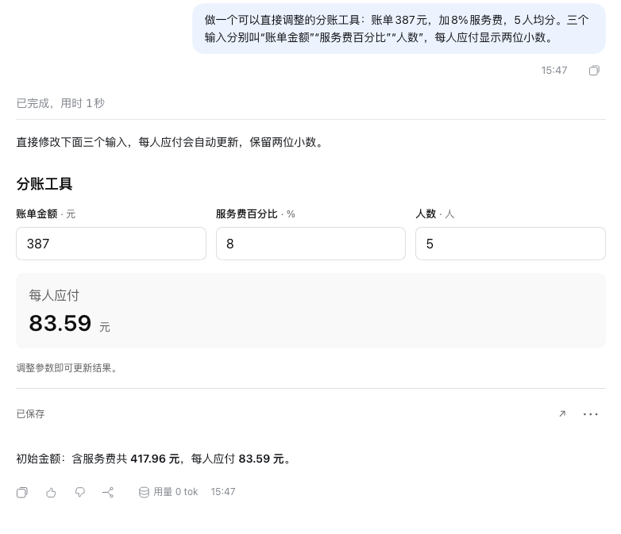

<a name="readme-top"></a>

<h1 align="center">DSH Intelligent UI</h1>

<p align="center"><strong>让 AI 的回答变成能直接动手调的小工具：改个数字，结果马上变。</strong><br>DeepSeek Harness 插件</p>

<p align="center"><strong>简体中文</strong> · <a href="README_EN.md">English</a></p>

<p align="center">
  <a href="https://github.com/gulagala001/dsh-intelligent-ui/releases/tag/v0.2.2-rc.3.iui.1.0.18"></a>
  <a href="https://github.com/gulagala001/dsh-intelligent-ui/releases"></a>
  <a href="#readme-install"></a>
  <a href="https://github.com/gulagala001/dsh-intelligent-ui/stargazers"></a>
</p>

<p align="center"><a href="#readme-install"><strong>开始使用</strong></a> · <a href="docs/usage.md">完整用法</a> · <a href="https://github.com/gulagala001/dsh-intelligent-ui/issues">反馈</a></p>

<p align="center"><a href="docs/images/iui-1.0-plan.png"></a></p>

<a id="installation"></a>
<a id="features"></a>
<a id="showcase"></a>
<a id="usage"></a>
<a id="updates"></a>
<a id="data"></a>
<a id="ecosystem"></a>
<a id="development"></a>
<a id="boundaries"></a>
<a id="limitations"></a>
<a id="compatibility"></a>
<a id="contributing"></a>
<a id="credits"></a>
<a name="readme-install"></a>

## 快速开始

**需要：** DSH **0.2.2-rc.3**，Node.js **24.9.0+**，以及一个在 DSH 里配好的模型。做出来的效果好不好，主要看模型。

### 1. 安装

在 DSH 里打开 **插件 → ＋ 添加插件**，粘贴：

```text
https://github.com/gulagala001/dsh-intelligent-ui/releases/download/v0.2.2-rc.3.iui.1.0.18/dsh-intelligent-ui-0.2.2-rc.3.iui.1.0.18.tgz
```

等手头的任务跑完，按提示完整重启 DSH，原来的设置和会话都还在。命令行安装、升级和卸载见[安装指南](docs/install.md)，校验文件：[SHA256SUMS](https://github.com/gulagala001/dsh-intelligent-ui/releases/download/v0.2.2-rc.3.iui.1.0.18/SHA256SUMS)。

### 2. 先试一件事

鼠标移到侧栏的 **新会话** 上，点右边出现的 **Chat**；或者在普通会话里输入 `/intelligent-ui`。然后问：

```text
做一个可调整的分账工具：账单387元，加8%服务费，5人均分。人数、金额和服务费都能修改。
```

回答里会出现一个分账工具，一开始每人 83.59 元。改人数或金额，结果当场更新，不会再调用模型。

## 能做什么

- **28 种组件**：文字、图片、卡片、指标、表格、图表、数字输入、下拉选择、滑块、清单和表单，可以和普通文字混排。
- **本地联动**：调金额、人数、筛选条件或者玩小游戏，都在本地算，不花模型用量。只有你点了提交，才会接着和模型对话。
- **保存和导出**：你调过的设置按会话保存，刷新、重开都还在。可以展开成单独页签，复制源文或导出数据。

### 调参数，马上看结果



还能做套餐对比、可勾选的清单、聚餐计划、图形模拟和小游戏。更多例子见[示例](docs/examples.md)。

## 使用范围

| 情况 | 说明 |
| --- | --- |
| 明暗主题、窄屏、键盘 | 跟随 DSH 的配色、字体和控件，都能用 |
| 刷新、重开、重启 DSH | 调过的设置会恢复；保存失败或冲突时会提示 |
| 导出 | 保存源文和 JSON 数据；要接着交互，仍需要装着本插件的 DSH |
| 安全 | 回答里只能用插件提供的组件和受限的计算表达式，不能运行任意 JavaScript，也拿不到你的文件、密钥或网络 |

作品设置存在 `DSH_HOME/intelligent-ui/state`。卸载后会话原文和作品设置都留着，重新安装就能接着用。

## 常见问题

<details>
<summary>找不到 Chat 入口？</summary>

把鼠标移到侧栏整格"新会话"上，或者用键盘聚焦它，Chat 气泡会出现在右侧；触屏和侧栏收起时会一直显示。还是没有的话，检查当前 profile 里插件是否已启用，然后重启 DSH。

</details>

<details>
<summary>模型只回了文字，或者作品显示解析错误？</summary>

用 Chat 入口或 `/intelligent-ui`，并明确说出想调整、选择或操作什么。作品出错时可以查看诊断和源文，再让模型修一下。插件不会自己反复重试，不会悄悄消耗用量。

</details>

<details>
<summary>我调参数时会发给模型吗？</summary>

不会。只有你点提交或继续对话时，相关内容才会发给模型。外部图片能不能显示，取决于图片来源。

</details>

## 开发和许可

安装包名是 `dsh-intelligent-ui`，只从本仓库的 Release 下载。[架构](docs/architecture.md) · [组件与协议](docs/contracts.md) · [使用说明](docs/usage.md)

代码用 [MIT](LICENSE) 许可。OpenUI 解析器、Apps SDK UI 设计变量等来源和许可见 [THIRD_PARTY_NOTICES.md](THIRD_PARTY_NOTICES.md)。

反馈问题请写明 DSH 和插件版本、所用模型、你的提问、期望和实际结果，日志和截图先去掉个人信息：[Issues](https://github.com/gulagala001/dsh-intelligent-ui/issues)。
