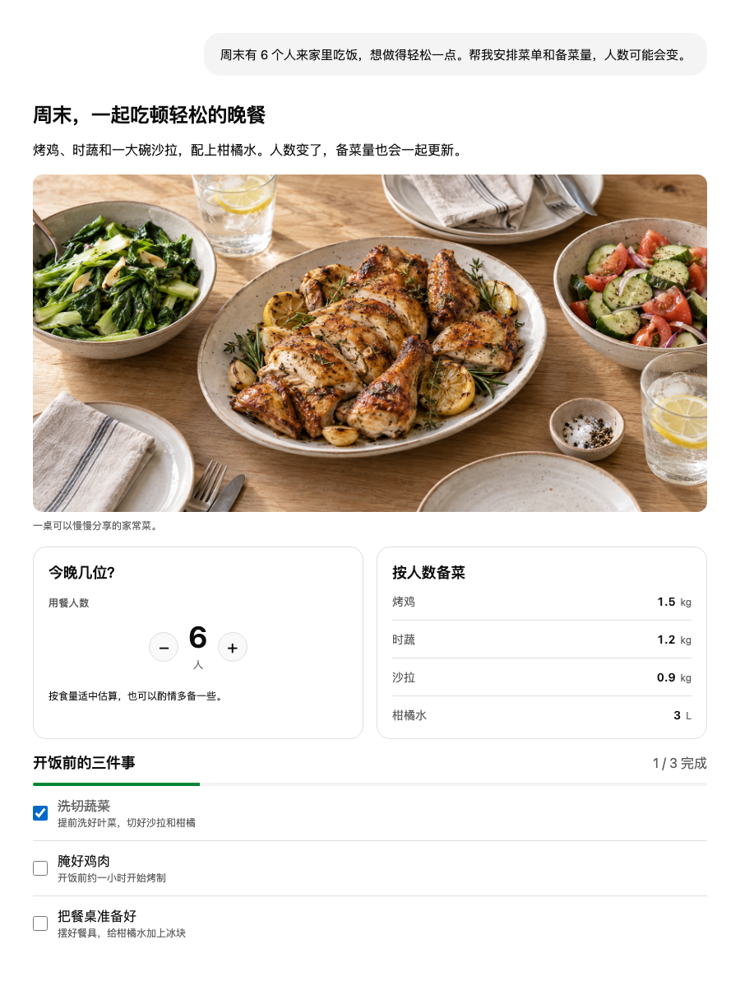
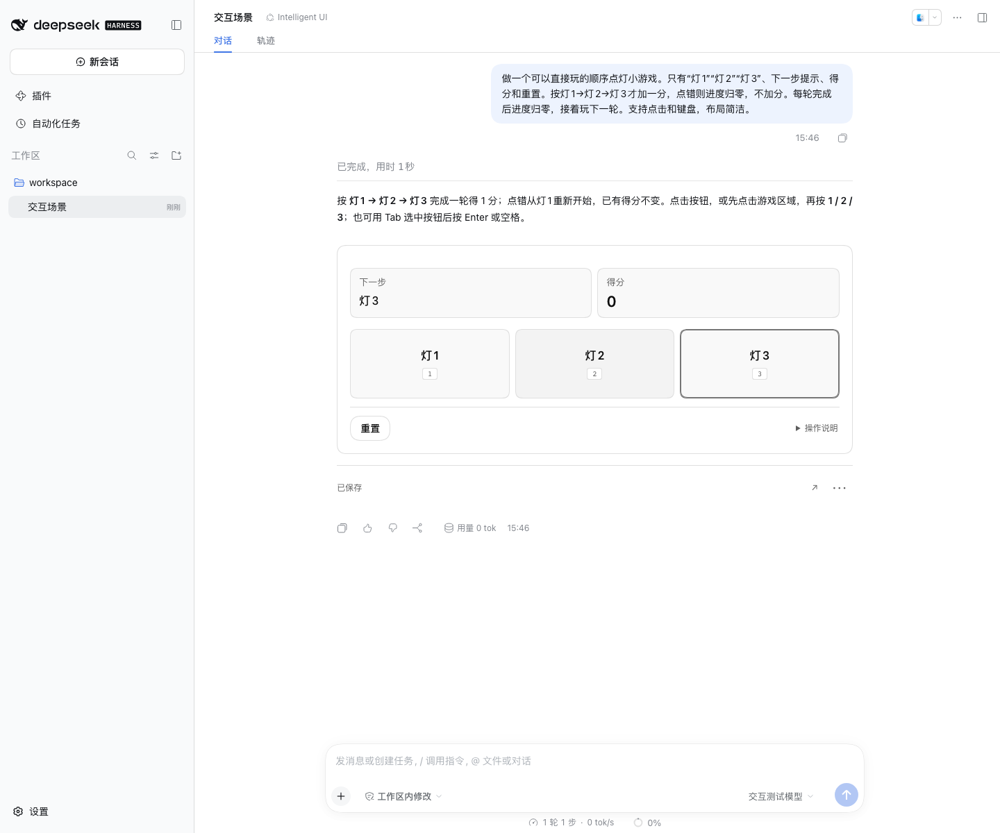
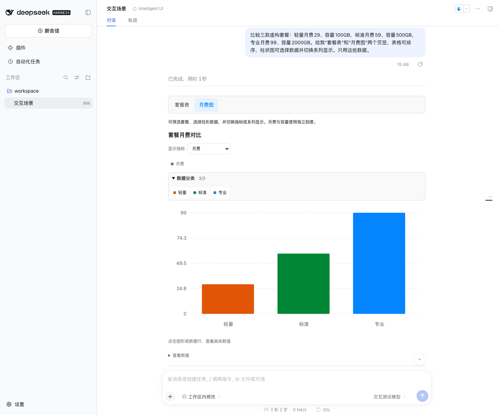
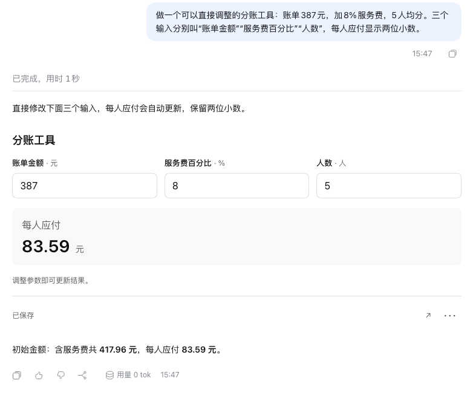
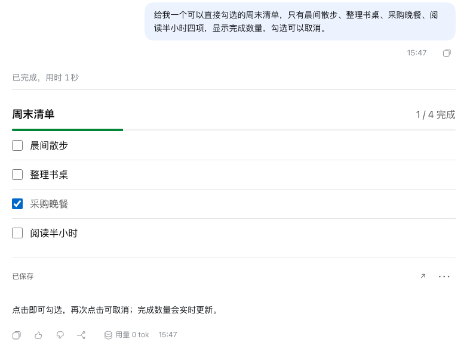
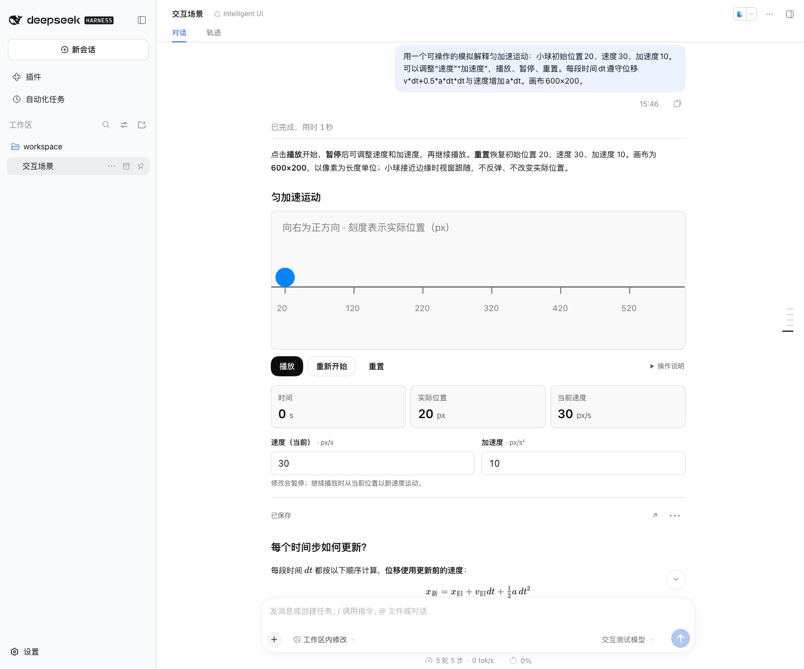
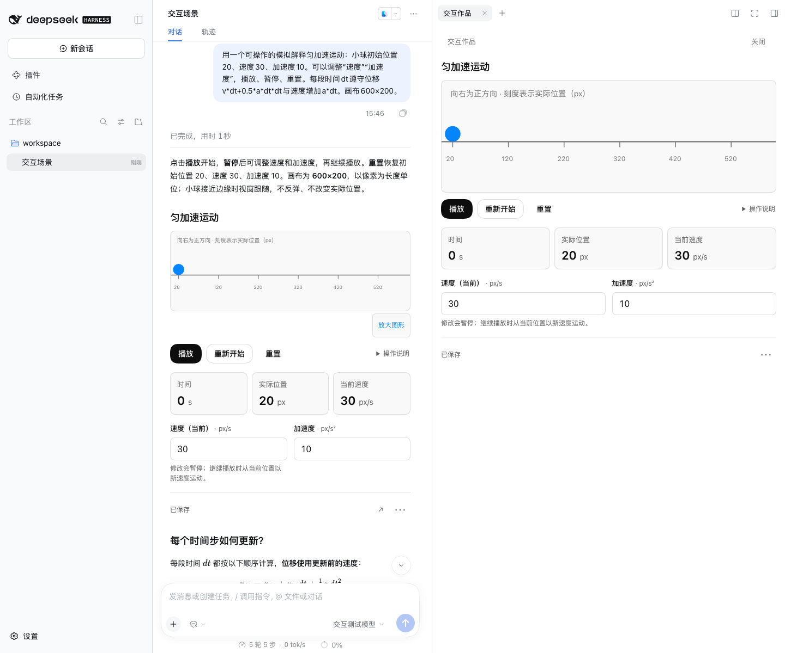
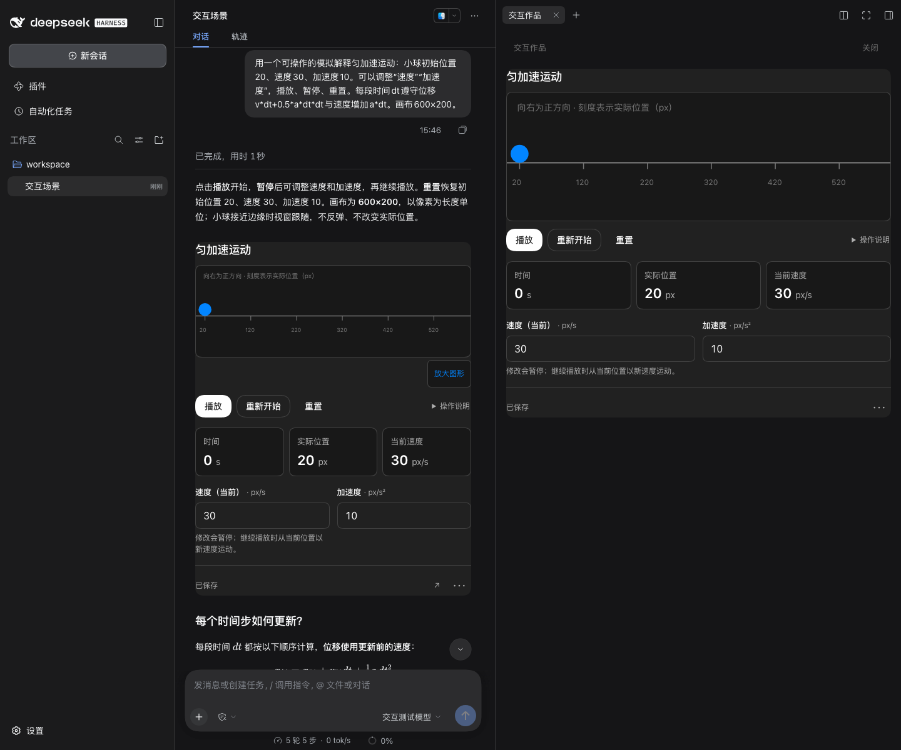

# DSH Intelligent UI

<div align="center">
  <a href="https://github.com/deepseek-ai/deepseek-harness"></a>
  <a href="https://github.com/gulagala001/dsh-intelligent-ui/releases"></a>
  <a href="https://nodejs.org/"></a>
  <a href="./LICENSE"></a>
  <br /><br />
  在 DSH 对话里调整参数、查看图表、勾选清单，或直接玩一个小游戏。<br />
  使用已有模型与会话，让回答带上合适的交互。
  <br /><br />
  🌏 <a href="./README.md"><strong>中文</strong></a> · <a href="./README_EN.md">English</a>
</div>

<br />



<p align="center"><sub>使用 IUI 1.0.0 实际组件与固定示例数据；餐食配图由 AI 生成。</sub></p>

**DSH Intelligent UI 是 [DeepSeek Harness（DSH）](https://github.com/deepseek-ai/deepseek-harness) 的独立 Web 插件。** 安装后可以创建智能聊天，也可以在普通 agent 中按需调用技能。模型、会话和工具循环沿用 DSH 原生能力；原版 DSH 可直接使用，Oh My DSH（OMD）是可选共存插件。

## 📑 目录

- [✨ 功能一览](#features)
- [🚀 安装](#installation)
- [🖼️ 真实场景](#showcase)
- [💡 开始使用](#usage)
- [🆕 最近更新](#updates)
- [💾 数据、更新与卸载](#data)
- [🔌 DSH 与插件生态](#ecosystem)
- [🛠️ 开发与构建](#development)
- [🔐 执行边界](#boundaries) · [⚠️ 已知限制](#limitations) · [🖥️ 平台与兼容性](#compatibility)
- [💬 反馈与贡献](#contributing) · [🔗 致谢与相关项目](#credits)

<a id="features"></a>

## ✨ 功能一览

- **💬 两个入口**：悬停“新会话”，点击右内侧的 **Chat** 气泡创建智能聊天；普通 agent 用 **`/intelligent-ui`** 按需生成交互回答。
- **🧩 28 个回答组件**：文字、图片、卡片、指标、表格、图表、数字输入、选择、滑块、清单与表单，可组合成一条回答；普通文字仍然保留。
- **🧮 本地联动**：调整金额、人数或其他参数，计算结果随之更新；勾选、排序、筛选和游戏操作不增加模型请求。明确提交后才继续对话。
- **📊 图表与数据**：排序表格，点选图形或数据行，切换系列和分类；作者标注单位后，月费与容量等不同量纲分组展示。
- **🎮 示意图、模拟与小游戏**：图形支持场景指定的点击、键盘和拖拽；非空间玩法可用语义操作卡。播放由用户开启，可保留参数重新开始或完整重置。
- **🌊 渐进呈现**：文字与多个交互段可以混合输出，生成时逐步预览，当前步骤完成并恢复设置后启用操作。
- **💾 保存与恢复**：作品设置按会话和消息保存，刷新、重开与宿主重启后恢复。内联与展开共享状态，保存失败或冲突有明确提示。
- **↗️ 展开与交付**：在 DSH 原生作品页签继续操作；更多菜单提供源文查看、复制与数据导出。窄回答中的图形可放大到原尺寸查看。
- **🌗 适应阅读环境**：明暗主题、窄屏排布和键盘操作；完整组件资料由 agent 按需读取。

<a id="installation"></a>

## 🚀 安装

**前置条件**：DSH Web 已能正常运行，Node.js **≥ 22.19**，已配置可用模型。

IUI **1.0.0** 提供三个分别对齐宿主 SDK 与依赖的构建。核对你的 **完整 DSH 版本**后选择对应安装包：

| DSH 宿主 | 下载 | 完整插件版本 |
| --- | --- | --- |
| `0.2.0-rc.2` | [rc.2 安装包](https://github.com/gulagala001/dsh-intelligent-ui/releases/download/v0.2.0-rc.2.iui.1.0.0/dsh-intelligent-ui-0.2.0-rc.2.iui.1.0.0.tgz) | `0.2.0-rc.2.iui.1.0.0` |
| `0.2.1-alpha.1` | [alpha.1 安装包](https://github.com/gulagala001/dsh-intelligent-ui/releases/download/v0.2.1-alpha.1.iui.1.0.0/dsh-intelligent-ui-0.2.1-alpha.1.iui.1.0.0.tgz) | `0.2.1-alpha.1.iui.1.0.0` |
| `0.2.1-alpha.2` | [alpha.2 安装包](https://github.com/gulagala001/dsh-intelligent-ui/releases/download/v0.2.1-alpha.2.iui.1.0.0/dsh-intelligent-ui-0.2.1-alpha.2.iui.1.0.0.tgz) | `0.2.1-alpha.2.iui.1.0.0` |

安装到你使用的 DSH profile，例如 alpha.2：

```sh
dsh plugin --profile web add https://github.com/gulagala001/dsh-intelligent-ui/releases/download/v0.2.1-alpha.2.iui.1.0.0/dsh-intelligent-ui-0.2.1-alpha.2.iui.1.0.0.tgz
```

将 `web` 换成实际 profile 名，另两个宿主使用表中相应 URL。也可以下载后使用 `file:/absolute/path/安装包.tgz` 安装。完成后重启该 profile 并刷新浏览器。

<details>
<summary><strong>从源码构建</strong></summary>

```sh
git clone https://github.com/gulagala001/dsh-intelligent-ui.git
cd dsh-intelligent-ui
npm ci --ignore-scripts

# 选择自己的完整宿主版本
node scripts/package-host.mjs 0.2.1-alpha.2
# 其他已验收构建：0.2.0-rc.2、0.2.1-alpha.1
```

安装包生成于 `work/packages/`。构建脚本为所选宿主锁定 SDK、依赖与完整包版本。

</details>

<details>
<summary><strong>常见问题</strong></summary>

| 现象 | 检查方式 |
| --- | --- |
| 看不到 Chat 入口 | 悬停整格“新会话”，确认插件装在当前 profile 且已启用；重启 profile 并刷新浏览器。 |
| 安装提示版本不兼容 | 核对完整 DSH 版本，选择相应构建。 |
| 模型只输出文字 | 使用 Chat 创建智能聊天，或调用 `/intelligent-ui`；描述希望调整、选择或操作的内容。生成质量取决于所选模型。 |
| 作品显示解析错误 | 查看诊断或复制源文，明确点击修复或请求原会话模型修正。 |

</details>

<a id="showcase"></a>

## 🖼️ 真实场景

下面五个场景来自 DSH 原生会话中的 **GPT-6.1-Sol** 生成结果。用一个自然问题开始，再在回答里操作。

### 按顺序点灯，直接玩一轮

> 做一个可以直接玩的顺序点灯小游戏。按灯1→灯2→灯3才加一分，点错则进度归零；完成后继续下一轮。支持点击和键盘，布局简洁。



三个操作卡、下一步提示与得分组成小游戏。可以直接点击，也可以聚焦卡片后按 Enter 或空格；重置回到起点。

### 看套餐表，也看不同单位的图

> 比较三款虚构套餐：轻量月费29、容量100GB，标准月费59、容量500GB，专业月费99、容量2000GB。给我“套餐表”和“月费图”两个页签，表格可排序，柱状图可选择数据并切换系列显示。



切换页签查看可排序表格与柱图。月费“元”和容量“GB”按作者标注的单位分别展示，点选图形或数据行可以查看明细。

### 改账单，立即算出每人应付

> 做一个可以直接调整的分账工具：账单387元，加8%服务费，5人均分。输入“账单金额”“服务费百分比”“人数”，每人应付显示两位小数。



初始每人应付 **83.59 元**；改成 250 元、12% 服务费、4 人后得到 **70.00 元**。计算在当前作品内完成。

### 把待办变成能勾选的清单

> 给我一个可以直接勾选的周末清单，只有晨间散步、整理书桌、采购晚餐、阅读半小时四项，显示完成数量，勾选可以取消。



勾选两项显示完成 2 项，取消一项后回到 1 项。完成状态与作品一起保存，回来后继续使用。

### 调整参数，观察匀加速运动

> 用一个可操作的模拟解释匀加速运动：小球初始位置20、速度30、加速度10。可以调整速度、加速度，播放、暂停、重置；位移与速度遵守匀加速公式。



改参数后模拟暂停，再点击播放观察变化。“重新开始”保留所选参数，“重置”还原初始设置；内联与展开共用状态，刷新后恢复并保持暂停。

<details>
<summary><strong>展开作品与深色主题</strong></summary>

在宿主作品页签中获得更大的操作空间，关闭后焦点回到原展开入口。



跟随 DSH 的明暗主题。



</details>

<sub>点灯、图表、分账与清单四题原始生成后直接完成交互；模拟使用同一真实生成原文回放验证，未重新请求模型。以上是给定模型与问题的实例，生成内容可能不同。图表部分配图为同输出视觉回放；来源见[配图说明](docs/images/showcase-notes.md)。</sub>

还可以组合聚餐计划、旅行表单、预算比较和交互示意图。表单明确提交后把所选字段交给原会话模型，继续生成方案。

<a id="usage"></a>

## 💡 开始使用

1. **创建智能聊天**：悬停“新会话”，点击右内侧的 **Chat** 气泡。新会话继承当前模型。
2. **或在普通 agent 中调用技能**：输入 **`/intelligent-ui`**，说明需要的交互回答。
3. **在回答里操作**：调整数字、勾选、筛选或切换视图，结果本地更新；需要模型继续时明确提交。
4. **展开和保留作品**：点击“展开”，或在“更多操作”（⋯）中复制源文、导出作品数据。


键盘聚焦“新会话”同样显示 Chat，可用 Tab 与 Enter 操作；触屏和折叠侧栏直接显示入口。点击格子的其他位置仍创建普通会话。

详细操作、图表选择、保存冲突和导出格式见 [使用说明](docs/usage.md)。

<a id="updates"></a>

## 🆕 最近更新

**IUI 1.0.0 · 首个正式版本**

包含此前内部迭代至 1.7 的完整功能：Chat 入口、渐进交互回答、28 个组件、图表单位分组与筛选、语义操作卡、拖拽与键盘操作、共享播放、保留参数重新开始、原尺寸查看、作品展开、保存恢复及导出。新作品使用组件版本 4，继续读取、编辑并按原版本导出版本 1、2、3 的作品。

提供 DSH `0.2.0-rc.2`、`0.2.1-alpha.1`、`0.2.1-alpha.2` 三个独立构建。详见 [发行说明](docs/release-1.0.0.md)、[CHANGELOG](CHANGELOG.md) 与 [Releases](https://github.com/gulagala001/dsh-intelligent-ui/releases)。

<a id="data"></a>

## 💾 数据、更新与卸载

作品设置保存在 DSH 数据目录的 `intelligent-ui/state`，按会话与原始消息区分。保存失败或并发冲突会显示状态，并保留本地编辑供重试；关闭页面前确认已经保存。

更新时安装对应宿主的新构建，重启 profile 并继续使用原 DSH 数据目录。导出包含版本、源文和当前 JSON 设置；重新运行交互仍需要本插件和兼容宿主。

```sh
dsh plugin --profile web remove dsh-intelligent-ui
```

卸载后重启 profile。会话原文与作品设置保留在宿主数据目录，重新安装可继续读取。

<a id="ecosystem"></a>

## 🔌 DSH 与插件生态

本插件复用 DSH 原生会话、模型、工具循环、技能与作品页签。普通 agent 仅增加简短技能索引，完整组件资料按需读取。

本仓库独立维护安装包、版本与生命周期。OMD 的推荐与共存接线是可选集成，当前已验证组合见下方兼容性表。

<a id="development"></a>

## 🛠️ 开发与构建

```sh
npm ci --ignore-scripts
npm run build
npm test
npm run test:host
```

客户端使用 React 18，复用 OpenUI 的低层语言解析与 Apps SDK UI 设计 token；组件、交互执行、状态保存与宿主接入由本插件维护。开发资料见 [资源与选型](docs/resource-research.md) 和 [模块契约](docs/contracts.md)。

<a id="boundaries"></a>

## 🔐 执行边界

交互使用受控组件、有界纯表达式与 Scene 数据协议。界面内的参数修改和游戏操作默认只更新本地状态，提交或继续对话由用户明确触发。

生成内容不执行任意 JavaScript，不获得宿主文件、凭据或网络权限。工具调用继续由 DSH 原生能力管理；无需 OpenUI Cloud、Thesys API 或额外 agent 服务。

<a id="limitations"></a>

## ⚠️ 已知限制

- 生成质量取决于所选模型；未知组件、无效表达式或不合适的布局会显示诊断，修复需明确发起。
- 完整交互依赖本插件与对应宿主；导出文件保存源文和状态。
- 外部图片可用性取决于来源，图片 URL 受到协议限制。
- 完全重复的数据行或无法确认稳定身份的超长行，点选仅在当前视图保留。
- 不同宿主须使用对应构建；未验收版本与设备的支持状态需另行确认。

<a id="compatibility"></a>

## 🖥️ 平台与兼容性

| 范围 | 当前验收边界 |
| --- | --- |
| macOS arm64 · 原版 DSH `0.2.0-rc.2` / `0.2.1-alpha.1` / `0.2.1-alpha.2` | 对应构建的安装、原生 CLI/Web、交互、恢复及生命周期 |
| OMD 共存 | 仅 DSH `0.2.1-alpha.2` + OMD `0.2.1-alpha.2.omd.0.15.1` 本地候选；两种安装顺序、启停、冷重启与两种卸载顺序 |
| 真实模型场景 | GPT-6.1-Sol，alpha.2；四题原始直接通过、一题真实生成同输出回放 |
| Windows / Linux / 原生桌面客户端 / 物理触屏 / 多屏 | 本次正式版本未完成同等实测 |

浏览器的明暗、窄屏与粗指针检查不等同于对应设备验收。历史版本的平台结果不外推为本次正式版本支持；具体交付与差异见 [发行说明](docs/release-1.0.0.md)。

<a id="contributing"></a>

## 💬 反馈与贡献

通过 [Issues](https://github.com/gulagala001/dsh-intelligent-ui/issues) 提交问题或建议。复现时提供完整 DSH 与插件版本、使用入口、最小提示词或可分享源文，以及预期和实际行为；私人数据请先脱敏。

欢迎通过 [Pull Requests](https://github.com/gulagala001/dsh-intelligent-ui/pulls) 改进组件、宿主适配、无障碍、文档与场景。实现应继续复用 DSH 原生能力，保持本地交互与明确提交的行为边界。

<a id="credits"></a>

## 🔗 致谢与相关项目

- [DeepSeek Harness](https://github.com/deepseek-ai/deepseek-harness)：原生宿主与插件能力。
- [OpenUI](https://github.com/thesysdev/openui)：低层语言解析。
- [Apps SDK UI](https://github.com/openai/apps-sdk-ui)：设计 token 参考。
- [DSH-better-sidebar](https://github.com/omdsh-dev/DSH-better-sidebar)：本仓库介绍结构参考与 DSH 生态项目。
- [Oh My DSH](https://github.com/gulagala001/oh-my-dsh)：可选共存与推荐集成。

本项目采用 [MIT License](LICENSE)。依赖版本、许可与来源见 [第三方声明](THIRD_PARTY_NOTICES.md)。
