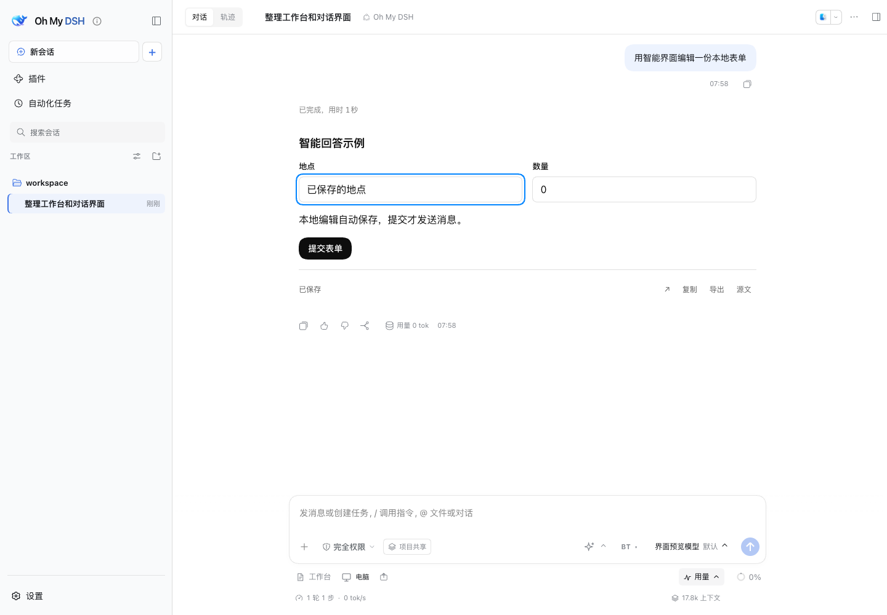
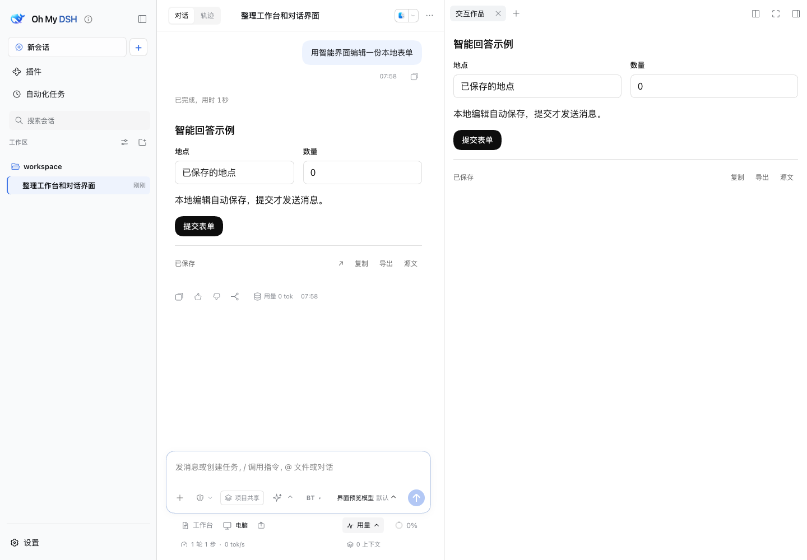

# DSH Intelligent UI

让 DSH 的回答变成可以直接操作的界面：调整数字、勾选计划、筛选图表、填写表单、探索模拟或玩小游戏。普通文字与交互内容可以混合出现，生成过程逐步展示。

界面参考 ChatGPT Intelligent UI，采用 OpenUI 语言解析和 OpenAI 官方设计基础；模型、会话与工具调用继续由 DSH 原生运行。生成质量取决于你选用的模型。

作为独立插件直接安装在普通 DSH 中使用，入口、技能、状态与作品恢复均随插件提供。OMD 用户也可使用同一个对应宿主的构建。

## 使用

- 点击“新会话”旁的小 **＋**，创建智能聊天。原“新会话”按钮仍按原来方式使用。
- 普通 agent 中输入 **`/intelligent-ui`**，或让 agent 按需调用同名 skill。平时只增加一条简短技能说明；完整规则与组件资料在需要时读取。
- 在回答里直接操作。改变控件会更新本地内容并保存设置；明确点击提交或继续才会向原会话发送消息。
- 点击回答底部的展开按钮，在原生作品页签查看；复制与导出可以保留源文和当前设置。

详细用法见 [使用说明](docs/usage.md)。资源与选型见 [资源调查](docs/resource-research.md)。

## 当前界面

以下为 macOS 隔离 profile 中 DSH 0.2.1-alpha.2 与 OMD 0.13 的原生实拍，使用 localhost 合成模型；表单是工程验收示例，不代表真实模型生成质量。图片来自先前的 1.0.3 验收；1.3.0 正在进行普通 DSH 独立验收。





## 安装

当前成品正在本地验收，**尚未正式发布**。安装与你的 **完整 DSH 版本一致**的本地构建；各宿主构建使用不同版本和资产，不能互换。正式渠道将在确认发布后开放。

```sh
# DSH 0.2.0-rc.2
dsh plugin --profile web add file:/absolute/path/dsh-intelligent-ui-0.2.0-rc.2.iui.1.3.0.tgz

# DSH 0.2.1-alpha.1
dsh plugin --profile web add file:/absolute/path/dsh-intelligent-ui-0.2.1-alpha.1.iui.1.3.0.tgz

# DSH 0.2.1-alpha.2
dsh plugin --profile web add file:/absolute/path/dsh-intelligent-ui-0.2.1-alpha.2.iui.1.3.0.tgz
```

将路径换成实际安装包的绝对路径，安装后重启对应 DSH profile。使用其他 profile 时把命令中的 `web` 替换为它的名称。OMD 的推荐入口已接入，公开下载会在正式发布后开放。运行需要 Node 22.19 或更新版本。

## 数据与卸载

设置保存在 DSH 数据目录的 `intelligent-ui/state`，每个作品按会话和原始消息分开。保存失败或并发修改会显示状态，保留本地编辑供重试；未保存时不要把关闭页面当作保存成功。复制与导出反馈独立显示，不会遮住保存或冲突状态；修复请求等待期间会禁用重复提交。触屏设备的小＋和回答工具栏提供更大的点击区域。

```sh
dsh plugin --profile web remove dsh-intelligent-ui
```

卸载后重启 profile，恢复原生界面。会话原文和已有作品设置继续留在宿主数据目录，重新安装可读取。

## 开发

```sh
npm ci --ignore-scripts
npm run build
npm test
npm run test:host
```

详细资料默认不进入普通 agent 上下文。运行时使用有界的纯表达式和 Scene 数据协议，所有复杂交互都不执行模型生成的 JavaScript。无需 OpenUI Cloud、Thesys API 或另一套 agent 服务。

MIT。依赖和参考来源见 [第三方声明](THIRD_PARTY_NOTICES.md)。实际验收范围随发行说明维护，不由 SDK peer 声明推断。
