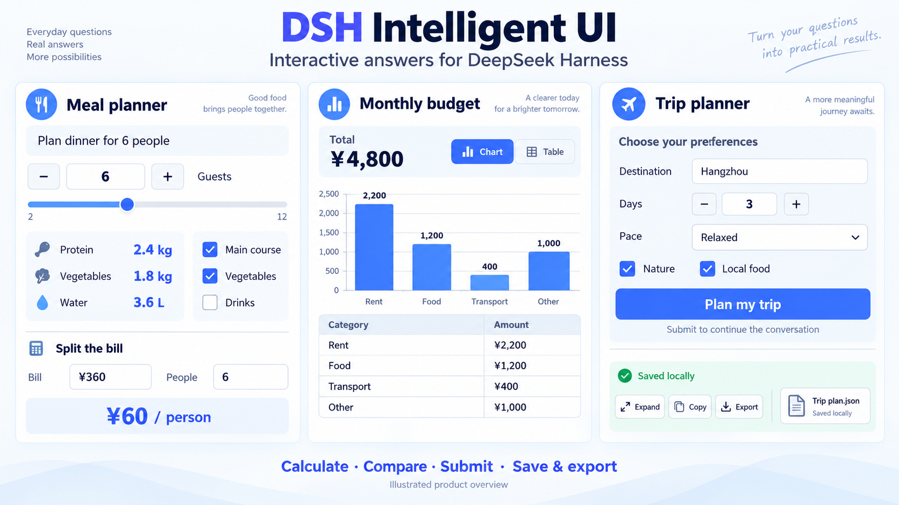

# DSH Intelligent UI

<div align="center">
  <strong>让回答变成可以直接操作的界面</strong><br /><br />
  <a href="https://github.com/deepseek-ai/deepseek-harness"></a>
  <a href="https://nodejs.org/"></a>
  <a href="./LICENSE"></a>
  <br /><br />
  在对话中调整参数、勾选计划、查看图表、填写表单、探索模拟与小游戏。<br />
  使用你已有的 DSH 模型与会话，交互就在回答里发生。
  <br /><br />
  🌏 <a href="./README.md"><strong>中文</strong></a> · <a href="./README_EN.md">English</a>
</div>

<br />



<p align="center"><sub>AI 生成的功能概览插画，展示本插件的交互场景。</sub></p>

**DSH Intelligent UI 是直接安装到 [DeepSeek Harness（DSH）](https://github.com/deepseek-ai/deepseek-harness) 的独立插件。** 安装、使用和更新由本仓库维护；无需先安装 Oh My DSH（OMD）。模型、会话、工具与技能沿用 DSH 原生能力。

> [!NOTE]
> 当前源码和本地构建可用，尚未正式发布。公开安装包将由本仓库提供；当前安装方式见下文。回答的内容与生成质量取决于所选模型。

## 📑 目录

- [✨ 功能一览](#features)
- [🚀 安装](#installation)
- [🖼️ 特性巡礼](#showcase)
- [💡 开始使用](#usage)
- [🆕 最近更新](#updates)
- [💾 数据、更新与卸载](#data)
- [🔌 DSH 与插件生态](#ecosystem)
- [🛠️ 开发与构建](#development)
- [🔐 执行边界](#boundaries) · [⚠️ 已知限制](#limitations) · [🖥️ 平台与兼容性](#compatibility)
- [💬 反馈与贡献](#contributing) · [🔗 致谢与相关项目](#credits)

<a id="features"></a>

## ✨ 功能一览

- **💬 两个使用入口**：新会话旁的小 **＋** 创建智能聊天；普通 agent 通过 **`/intelligent-ui`** 按需生成交互回答。
- **🧩 28 个回答组件**：文字、图片、卡片、指标、表格、图表、数字输入、选择、滑块、清单与表单，可组合成一条回答。
- **🧮 即时计算**：调整人数、金额或其他参数，公式和结果随之更新；界面内的本地操作不增加模型请求。
- **📊 可操作的数据展示**：表格排序、图表系列选择、标签页与明细查看，帮助比较数据和方案。
- **🎮 模拟与小游戏**：交互示意图、参数模拟和 Scene 场景，通过点击、键盘与显式播放探索变化。
- **🌊 渐进回答**：普通文字与多个交互段混合出现，生成过程中逐步呈现。
- **💾 保存与恢复**：作品状态按会话和消息保存；刷新、重开与宿主重启后恢复，并显示保存或冲突状态。
- **↗️ 展开与交付**：在原生作品页签继续操作，复制源文或导出带版本、源文和当前设置的数据。
- **🌗 跟随使用环境**：明暗主题、响应式布局和键盘操作；普通 agent 的完整组件资料按需读取。

<a id="installation"></a>

## 🚀 安装

**前置条件**：DSH 的 Web 界面已能正常运行，Node.js **≥ 22.19**，已配置可用模型。

当前 `main` 的插件版本为 **IUI 1.0.0**，提供两个与宿主 SDK 分别对齐的构建。使用与你的 **完整 DSH 版本一致**的安装包：

| DSH 宿主版本 | 对应插件包 | 当前状态 |
| --- | --- | --- |
| `0.2.0-rc.2` | `dsh-intelligent-ui-0.2.0-rc.2.iui.1.0.0.tgz` | 本地构建已验收 |
| `0.2.1-alpha.1` | `dsh-intelligent-ui-0.2.1-alpha.1.iui.1.0.0.tgz` | 本地构建已验收 |

拿到对应构建后，安装到所用的 DSH profile：

```sh
# DSH 0.2.0-rc.2
dsh plugin --profile web add file:/absolute/path/dsh-intelligent-ui-0.2.0-rc.2.iui.1.0.0.tgz

# DSH 0.2.1-alpha.1
dsh plugin --profile web add file:/absolute/path/dsh-intelligent-ui-0.2.1-alpha.1.iui.1.0.0.tgz
```

把路径换成实际安装包的绝对路径；`web` 换成你使用的 profile 名。安装后重启该 profile，再刷新浏览器，即可使用小＋和技能入口。**原版 DSH 可以直接使用，OMD 是可选的共存插件。**

<details>
<summary><strong>从源码构建安装包</strong></summary>

```sh
git clone https://github.com/gulagala001/dsh-intelligent-ui.git
cd dsh-intelligent-ui
npm ci --ignore-scripts

# 选择自己的完整宿主版本
node scripts/package-host.mjs 0.2.0-rc.2
# 或
node scripts/package-host.mjs 0.2.1-alpha.1
```

安装包生成于 `work/packages/`，再用上面的 `file:` 命令安装。构建脚本为所选宿主锁定 SDK、依赖与包版本。

</details>

<details>
<summary><strong>常见问题</strong></summary>

| 现象 | 检查方式 |
| --- | --- |
| 找不到公开下载或 npm 安装入口 | 当前尚未正式发布；使用本地安装包或从源码构建。 |
| 安装后没有小＋或交互回答 | 确认装在当前 profile，重启该 profile 并刷新浏览器，检查插件是否启用。 |
| 宿主提示插件版本不兼容 | 核对完整 DSH 版本与安装包，选择对应构建。 |
| 模型仍然只输出文字 | 使用小＋创建智能聊天，或在普通 agent 中调用 `/intelligent-ui`，并明确描述需要的交互。 |
| 作品显示解析错误 | 查看诊断、复制源文，明确点击修复或请求原会话模型修正。 |

</details>

<a id="showcase"></a>

## 🖼️ 特性巡礼

以下展示可组合的使用场景，真实界面截图与录屏后续补充。

| | |
| --- | --- |
| **🧮 聚餐计划与分账**<br />调整人数，联动更新食材数量；填写总金额与服务费，直接查看每人应付。<br /><sub>场景截图待补</sub> | **📊 预算与方案比较**<br />将指标、图表、可排序表格和标签页放在同一回答中，选择系列、查看明细。<br /><sub>场景截图待补</sub> |
| **✅ 清单与参数调整**<br />勾选待办、切换选项、拖动滑块，结果在当前回答内更新并保存。<br /><sub>场景截图待补</sub> | **📝 表单与继续对话**<br />填写目的地、天数与偏好，明确提交后把选择发送给原会话，继续生成方案。<br /><sub>场景截图待补</sub> |
| **🎮 示意图、模拟与小游戏**<br />选择节点查看说明，通过参数、点击和键盘探索场景；播放由用户主动开启。<br /><sub>场景截图待补</sub> | **↗️ 作品、恢复与导出**<br />内联回答与展开页签共享设置，恢复已保存状态，复制源文或导出作品数据。<br /><sub>场景截图待补</sub> |

<a id="usage"></a>

## 💡 开始使用

1. **创建智能聊天**：点击“新会话”旁的小 **＋**，使用当前 DSH 模型开始提问。
2. **或在普通 agent 中调用技能**：输入 **`/intelligent-ui`**，说明希望获得的交互内容。
3. **在回答里操作**：调整数字、选择、勾选或切换视图，查看本地更新；需要模型继续时明确提交。
4. **展开和保留作品**：点击回答底部的展开、复制或导出入口。

可以这样提问：

```text
做一个 6 人聚餐采购计划，让我调整人数时食材数量一起变化。
账单 360 元，6 人分摊，做一个能调整金额、人数和服务费的计算器。
把这份支出做成图表和可排序表格，方便比较各项预算。
做一个旅行表单，收集目的地、天数和节奏，提交后再规划行程。
用能点击的示意图解释一个原理，再加一个参数模拟。
```

详细操作、保存冲突和导出格式见 [使用说明](docs/usage.md)。

<a id="updates"></a>

## 🆕 最近更新

**IUI 1.0.0 · 当前源码版本，待正式发布**

- 小＋智能聊天与普通 agent 按需技能。
- 混合文字、渐进交互回答、计算器、图表、表单和 Scene 场景。
- 保存、并发冲突处理、重开恢复、作品展开与数据导出。
- 分别对齐 DSH `0.2.0-rc.2` / `0.2.1-alpha.1` 的独立构建。

完整记录见 [CHANGELOG](CHANGELOG.md)，正式发行将由本仓库的 [Releases](https://github.com/gulagala001/dsh-intelligent-ui/releases) 提供。

<a id="data"></a>

## 💾 数据、更新与卸载

设置保存在 DSH 数据目录的 `intelligent-ui/state`，按会话和原始消息区分。保存失败或并发冲突会显示状态并保留本地编辑供重试；关闭页面前应确认已保存。

更新时安装对应宿主的新构建并重启 profile，继续使用原 DSH 数据目录。导出保存版本、源文和当前 JSON 设置，重新运行交互仍需要本插件与兼容的 DSH。

```sh
dsh plugin --profile web remove dsh-intelligent-ui
```

卸载后重启 profile。会话原文与已有作品设置保留在宿主数据目录，重新安装可继续读取。

<a id="ecosystem"></a>

## 🔌 DSH 与插件生态

本插件使用 DSH 原生会话、模型、工具循环、技能和作品页签；小＋提供专用聊天入口，普通 agent 仅增加简短技能索引，完整资料按需读取。

**OMD 的推荐与共存接线是可选集成。** 本插件拥有独立仓库、安装包、版本、文档和生命周期，核心使用流程由原版 DSH 与本插件完成。其他插件的共存范围按实际验收组合记录。

<a id="development"></a>

## 🛠️ 开发与构建

```sh
npm ci --ignore-scripts
npm run build
npm test
npm run test:host
```

客户端使用 React 18，复用 OpenUI 的低层语言解析与 Apps SDK UI 设计 token；组件、交互执行、状态保存和宿主接入由本插件维护。开发资料见 [资源与选型](docs/resource-research.md) 和 [模块契约](docs/contracts.md)。

<a id="boundaries"></a>

## 🔐 执行边界

交互通过受控组件、有界纯表达式和 Scene 数据协议执行。界面内的参数修改和操作默认只更新本地状态，提交或继续对话由用户明确触发。

生成内容不执行任意 JavaScript；宿主文件、凭据、网络与工具调用继续由 DSH 的原生能力管理。使用本插件无需 OpenUI Cloud、Thesys API 或额外的 agent 服务。

<a id="limitations"></a>

## ⚠️ 已知限制

- 模型可能生成未知组件、无效表达式或不合适的布局；作品会显示诊断，修复需明确发起。
- 导出包含可重现的源文和状态；完整交互依赖插件与对应宿主。
- 外部图片的可用性取决于来源；生成内容使用受限图片 URL。
- 不同宿主版本须使用对应构建，未验收版本的支持状态另行确认。

<a id="compatibility"></a>

## 🖥️ 平台与兼容性

| 范围 | 已有验收 |
| --- | --- |
| DSH `0.2.0-rc.2` / `0.2.1-alpha.1` | 对应构建的安装与原生 Web 流程 |
| macOS / Linux / Windows，Node 24 | 安装包与原生 Web 生命周期验收 |
| 与对应 OMD 共存 | macOS 的加载顺序、启停、重启与卸载 |
| 原生桌面 App / Windows Node 22.19 | 尚未完成同等验收 |

宿主矩阵和执行结果可在 [GitHub Actions](https://github.com/gulagala001/dsh-intelligent-ui/actions/workflows/ci.yml) 查看，支持范围以具体构建的验收记录为准。

<a id="contributing"></a>

## 💬 反馈与贡献

在 [Issues](https://github.com/gulagala001/dsh-intelligent-ui/issues) 提交问题或建议。复现时请提供完整 DSH 与插件版本、使用入口、最小提示词或可分享的源文，以及预期和实际行为；涉及私人数据时先做脱敏。

欢迎通过 [Pull Requests](https://github.com/gulagala001/dsh-intelligent-ui/pulls) 改进组件、宿主适配、无障碍、文档和场景展示。实现应继续复用 DSH 原生能力，并保持本地交互与明确提交的行为边界。

<a id="credits"></a>

## 🔗 致谢与相关项目

- [DeepSeek Harness](https://github.com/deepseek-ai/deepseek-harness)：原生宿主与插件能力。
- [OpenUI](https://github.com/thesysdev/openui)：低层语言解析。
- [Apps SDK UI](https://github.com/openai/apps-sdk-ui)：设计 token 参考。
- [DSH-better-sidebar](https://github.com/omdsh-dev/DSH-better-sidebar)：本仓库介绍结构参考与 DSH 生态项目。
- [Oh My DSH](https://github.com/gulagala001/oh-my-dsh)：可选共存与推荐集成。

本项目采用 [MIT License](LICENSE)。依赖版本、许可与来源见 [第三方声明](THIRD_PARTY_NOTICES.md)。
