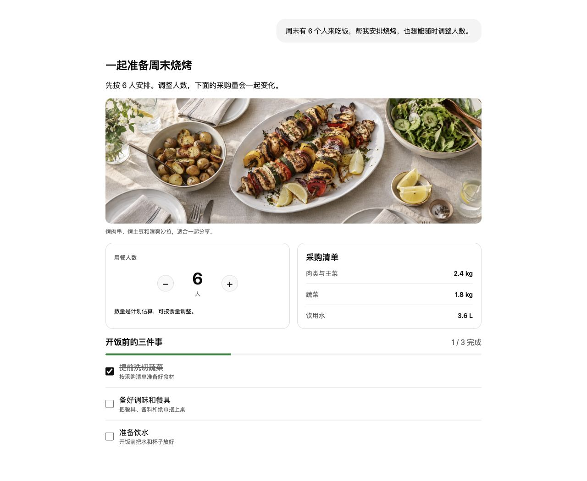
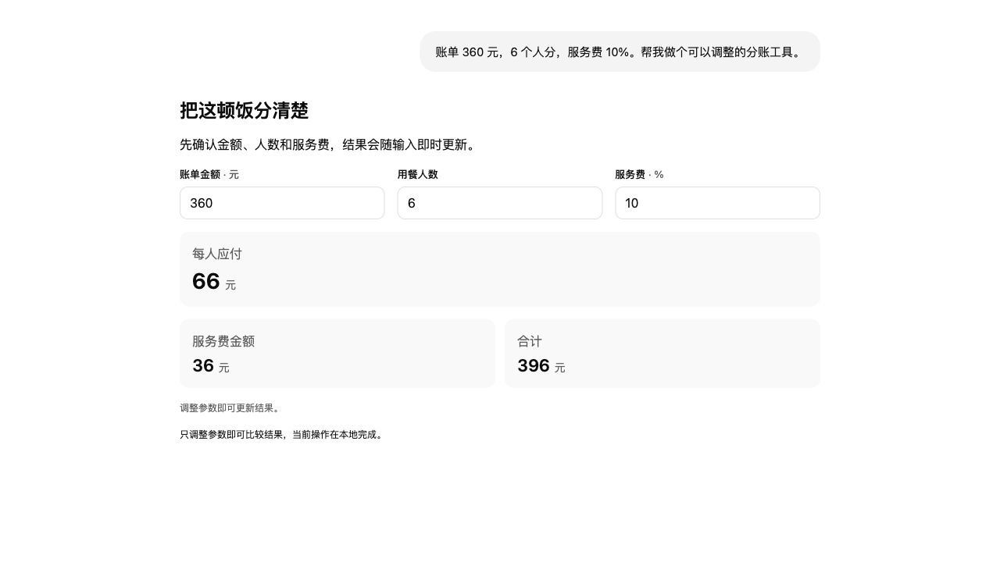
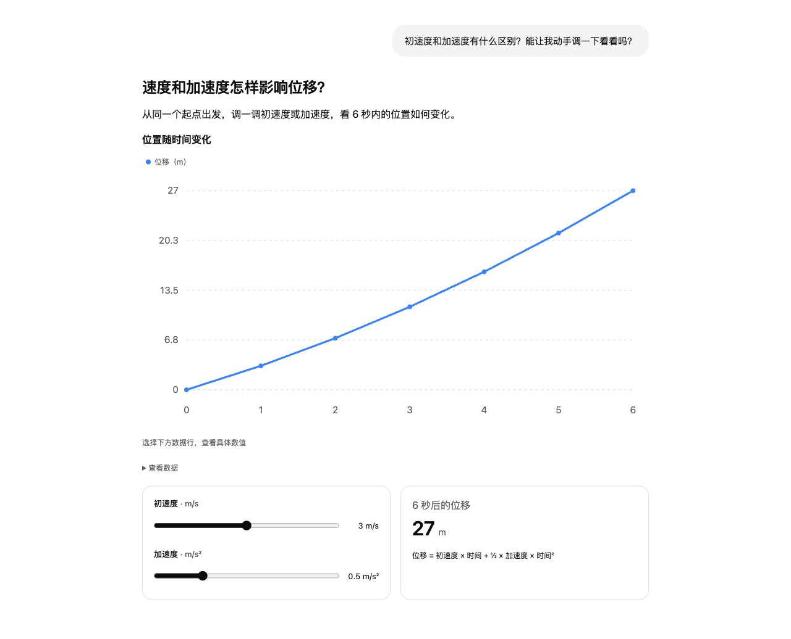

# DSH Intelligent UI

<div align="center">
  <strong>Turn answers into interfaces you can use</strong><br /><br />
  <a href="https://github.com/deepseek-ai/deepseek-harness"></a>
  <a href="https://nodejs.org/"></a>
  <a href="./LICENSE"></a>
  <br /><br />
  Adjust parameters, check off plans, explore charts, fill out forms, and try simulations and games—all in your conversation.<br />
  Use your existing DSH models and sessions, with interactions built into the answer.
  <br /><br />
  🌏 <a href="./README.md">中文</a> · <a href="./README_EN.md"><strong>English</strong></a>
</div>

<br />



<p align="center"><sub>Example scenarios rendered with the plugin's actual components and fixed sample data. The food image is AI-generated.</sub></p>

**DSH Intelligent UI is a standalone plugin installed directly in [DeepSeek Harness (DSH)](https://github.com/deepseek-ai/deepseek-harness).** This repository maintains its installation, usage, and updates; Oh My DSH (OMD) is optional. Models, sessions, tools, and skills use DSH's native capabilities.

> [!NOTE]
> Source code and local builds are available; an official release is still pending. Public packages will be provided by this repository. See below for the current installation method. Answer content and generation quality depend on the selected model.

## 📑 Contents

- [✨ Features](#features)
- [🚀 Installation](#installation)
- [🖼️ Feature tour](#showcase)
- [💡 Getting started](#usage)
- [🆕 Recent updates](#updates)
- [💾 Data, updates, and removal](#data)
- [🔌 DSH and the plugin ecosystem](#ecosystem)
- [🛠️ Development and builds](#development)
- [🔐 Execution boundaries](#boundaries) · [⚠️ Known limitations](#limitations) · [🖥️ Platforms and compatibility](#compatibility)
- [💬 Feedback and contributions](#contributing) · [🔗 Credits and related projects](#credits)

<a id="features"></a>

## ✨ Features

- **💬 Two ways to start**: the small **＋** beside New Session creates an intelligent chat; regular agents can generate interactive answers on demand with **`/intelligent-ui`**.
- **🧩 28 answer components**: combine text, images, cards, metrics, tables, charts, numeric inputs, selectors, sliders, checklists, and forms in a single answer.
- **🧮 Instant calculations**: change a headcount, amount, or other parameter and see formulas and results update. Local interactions within the interface add no model requests.
- **📊 Interactive data views**: sort tables, select chart series, switch tabs, and inspect details to compare data and options.
- **🎮 Simulations and games**: explore interactive diagrams, parameter simulations, and Scene content through clicks, keyboard controls, and playback you explicitly start.
- **🌊 Progressive answers**: ordinary text and multiple interactive sections can appear together, rendering progressively during generation.
- **💾 Save and restore**: artifact state is saved by session and message, restored after refreshes, reopening, or host restarts, with visible save and conflict status.
- **↗️ Expand and export**: continue interacting in a native artifact tab, copy the source, or export data containing the version, source, and current settings.
- **🌗 Fits your environment**: light and dark themes, responsive layouts, and keyboard interaction; regular agents load detailed component documentation on demand.

<a id="installation"></a>

## 🚀 Installation

**Prerequisites**: a working DSH Web interface, Node.js **≥ 22.19**, and a configured model.

The plugin version on `main` is currently **IUI 1.0.0**, with two builds aligned to their respective host SDKs. Use the package matching your **full DSH version**:

| DSH host version | Plugin package | Current status |
| --- | --- | --- |
| `0.2.0-rc.2` | `dsh-intelligent-ui-0.2.0-rc.2.iui.1.0.0.tgz` | Local build validated |
| `0.2.1-alpha.1` | `dsh-intelligent-ui-0.2.1-alpha.1.iui.1.0.0.tgz` | Local build validated |

Once you have the matching build, install it in the DSH profile you use:

```sh
# DSH 0.2.0-rc.2
dsh plugin --profile web add file:/absolute/path/dsh-intelligent-ui-0.2.0-rc.2.iui.1.0.0.tgz

# DSH 0.2.1-alpha.1
dsh plugin --profile web add file:/absolute/path/dsh-intelligent-ui-0.2.1-alpha.1.iui.1.0.0.tgz
```

Replace the path with the package's actual absolute path, and replace `web` with your profile name. Restart that profile and refresh the browser to use the small ＋ and skill entry point. **It works directly with stock DSH; OMD is an optional companion plugin.**

<details>
<summary><strong>Build an installation package from source</strong></summary>

```sh
git clone https://github.com/gulagala001/dsh-intelligent-ui.git
cd dsh-intelligent-ui
npm ci --ignore-scripts

# Choose your full host version
node scripts/package-host.mjs 0.2.0-rc.2
# Or
node scripts/package-host.mjs 0.2.1-alpha.1
```

Packages are generated in `work/packages/`; install one using the `file:` command above. The build script pins the SDK, dependencies, and package version for the selected host.

</details>

<details>
<summary><strong>Troubleshooting</strong></summary>

| Symptom | What to check |
| --- | --- |
| No public download or npm installation available | An official release is still pending. Use a local package or build from source. |
| No small ＋ or interactive answers after installation | Confirm installation in the current profile, restart that profile, refresh the browser, and check that the plugin is enabled. |
| The host reports an incompatible plugin version | Check the full DSH version and select its matching package. |
| The model still responds with text only | Start an intelligent chat with the small ＋, or invoke `/intelligent-ui` in a regular agent, and describe the interaction you want. |
| An artifact shows a parsing error | Read the diagnostics, copy the source, and explicitly start a repair or ask the original session's model to correct it. |

</details>

<a id="showcase"></a>

## 🖼️ Feature tour

### Change the inputs, see the answer update

Enter a bill, headcount, and service charge to compare each person's share and the total. The numbers and controls use the plugin's actual calculator component.



### Explore the controls to understand what changes

Adjust initial velocity or acceleration and see both the curve and displacement after 6 seconds. Charts, sliders, and metrics work together in one explanation.



These fixed scenarios show actual components and local updates. See the [image notes](docs/images/showcase-notes.md) for sources and the scope of the examples.

More scenarios you can build by combining components:

| | |
| --- | --- |
| **🧮 Meal planning and bill splitting**<br />Adjust the number of guests to update ingredient quantities; enter the total and service charge to see each person's share. | **📊 Budgets and option comparisons**<br />Combine metrics, charts, sortable tables, and tabs in one answer, select series, and inspect details. |
| **✅ Checklists and parameter controls**<br />Check off tasks, change options, and move sliders. Results update and save within the current answer. | **📝 Forms and follow-up conversations**<br />Enter a destination, duration, and preferences. An explicit submission sends your choices to the original session to continue planning. |
| **🎮 Diagrams, simulations, and games**<br />Select nodes to read explanations and explore scenes through parameters, clicks, and keyboard controls. Playback starts when you choose. | **↗️ Artifacts, restoration, and export**<br />The inline answer and expanded tab share settings. Restore saved state, copy the source, or export artifact data. |

<a id="usage"></a>

## 💡 Getting started

1. **Create an intelligent chat**: click the small **＋** beside New Session and ask a question using your current DSH model.
2. **Or invoke the skill in a regular agent**: enter **`/intelligent-ui`** and describe the interactive content you want.
3. **Interact within the answer**: adjust numbers, select options, check items, or switch views to see local updates. Explicitly submit when you want the model to continue.
4. **Expand and keep your artifact**: use the expand, copy, or export controls at the bottom of the answer.

Try prompts like these:

```text
Make a grocery plan for a dinner with 6 people, with ingredient quantities that change when I adjust the headcount.
Split a 360 yuan bill among 6 people. Make a calculator with adjustable amount, headcount, and service charge.
Turn these expenses into charts and a sortable table so I can compare budget categories.
Make a travel form to collect the destination, number of days, and pace, then plan the itinerary after submission.
Explain a concept with a clickable diagram, and add a parameter simulation.
```

See the [usage guide](docs/usage.md) for detailed controls, save conflicts, and export formats.

<a id="updates"></a>

## 🆕 Recent updates

**IUI 1.0.0 · Current source version; official release pending**

- Intelligent chats through the small ＋ and an on-demand skill for regular agents.
- Mixed text and progressive interactive answers, calculators, charts, forms, and Scene content.
- Saving, concurrent conflict handling, restoration after reopening, expanded artifacts, and data export.
- Separate builds aligned to DSH `0.2.0-rc.2` / `0.2.1-alpha.1`.

See the [CHANGELOG](CHANGELOG.md) for the full history. Official packages will be available through this repository's [Releases](https://github.com/gulagala001/dsh-intelligent-ui/releases).

<a id="data"></a>

## 💾 Data, updates, and removal

Settings are stored in `intelligent-ui/state` within the DSH data directory, separated by session and original message. Save failures and concurrent conflicts display a status and preserve local edits for retry. Confirm that changes are saved before closing the page.

To update, install the new build matching your host, restart the profile, and keep using the same DSH data directory. Exports contain the saved version, source, and current JSON settings; running the interactions again requires this plugin and a compatible DSH host.

```sh
dsh plugin --profile web remove dsh-intelligent-ui
```

Restart the profile after removal. Original conversation content and existing artifact settings remain in the host data directory and can be read again after reinstalling.

<a id="ecosystem"></a>

## 🔌 DSH and the plugin ecosystem

The plugin uses DSH's native sessions, models, tool loop, skills, and artifact tabs. The small ＋ provides a dedicated chat entry point; regular agents receive only a short skill index and load full documentation on demand.

**OMD recommendations and coexistence wiring are optional integrations.** This plugin has its own repository, packages, versions, documentation, and lifecycle. Its core workflow runs with stock DSH and this plugin. Coexistence with other plugins is documented for combinations that have actually been validated.

<a id="development"></a>

## 🛠️ Development and builds

```sh
npm ci --ignore-scripts
npm run build
npm test
npm run test:host
```

The client uses React 18, OpenUI's low-level language parser, and Apps SDK UI design tokens. This plugin maintains its components, interaction execution, state persistence, and host integration. See [resources and technology choices](docs/resource-research.md) and [module contracts](docs/contracts.md) for development details.

<a id="boundaries"></a>

## 🔐 Execution boundaries

Interactions run through controlled components, bounded pure expressions, and the Scene data protocol. Parameter changes and interface interactions update local state by default; submissions and follow-up conversations require an explicit user action.

Generated content does not execute arbitrary JavaScript. Host files, credentials, network access, and tool calls remain managed by DSH's native capabilities. The plugin requires no OpenUI Cloud, Thesys API, or additional agent service.

<a id="limitations"></a>

## ⚠️ Known limitations

- Models may generate unknown components, invalid expressions, or unsuitable layouts. Artifacts show diagnostics; repairs must be explicitly started.
- Exports contain reproducible source and state. Full interaction depends on the plugin and matching host.
- External image availability depends on the source; generated content uses restricted image URLs.
- Each host version requires its matching build. Support for versions that have not been validated must be confirmed separately.

<a id="compatibility"></a>

## 🖥️ Platforms and compatibility

| Scope | Validation completed |
| --- | --- |
| DSH `0.2.0-rc.2` / `0.2.1-alpha.1` | Installation and native Web workflows for the matching builds |
| macOS / Linux / Windows, Node 24 | Package installation and native Web lifecycle validation |
| Coexistence with matching OMD versions | Load order, enable/disable, restart, and removal on macOS |
| Native desktop app / Windows Node 22.19 | Equivalent validation still pending |

See [GitHub Actions](https://github.com/gulagala001/dsh-intelligent-ui/actions/workflows/ci.yml) for the host matrix and execution results. Supported scope follows the validation records for each build.

<a id="contributing"></a>

## 💬 Feedback and contributions

Report problems or suggestions in [Issues](https://github.com/gulagala001/dsh-intelligent-ui/issues). For reproduction, include the full DSH and plugin versions, entry point used, a minimal prompt or shareable source, and expected versus actual behavior. Remove private data before sharing.

[Pull Requests](https://github.com/gulagala001/dsh-intelligent-ui/pulls) improving components, host compatibility, accessibility, documentation, and scenario showcases are welcome. Implementations should continue using DSH's native capabilities and preserve the boundaries between local interactions and explicit submissions.

<a id="credits"></a>

## 🔗 Credits and related projects

- [DeepSeek Harness](https://github.com/deepseek-ai/deepseek-harness): native host and plugin capabilities.
- [OpenUI](https://github.com/thesysdev/openui): low-level language parsing.
- [Apps SDK UI](https://github.com/openai/apps-sdk-ui): design token reference.
- [DSH-better-sidebar](https://github.com/omdsh-dev/DSH-better-sidebar): a DSH ecosystem project and the structural reference for this README.
- [Oh My DSH](https://github.com/gulagala001/oh-my-dsh): optional coexistence and recommendation integration.

This project uses the [MIT License](LICENSE). See [third-party notices](THIRD_PARTY_NOTICES.md) for dependency versions, licenses, and sources.
