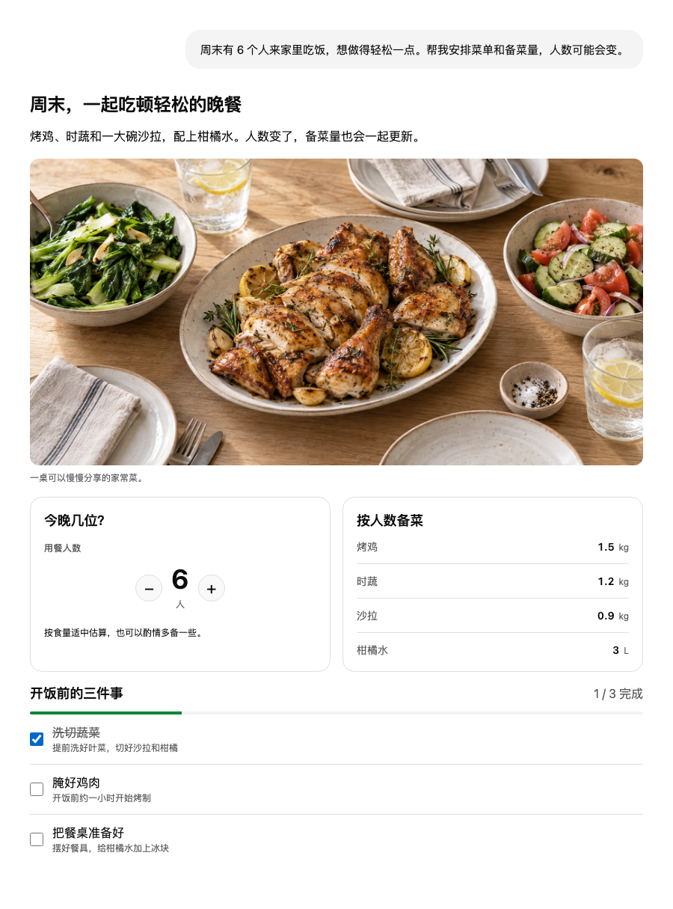
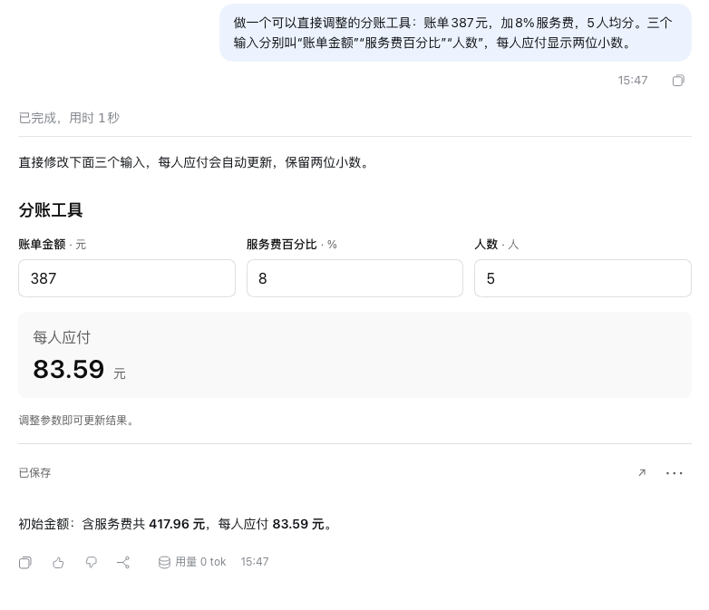

<a name="readme-top"></a>

<h1 align="center">DSH Intelligent UI</h1>

<p align="center"><strong>Turn AI answers into small tools you can work with: change a number and the result updates instantly.</strong><br>A DeepSeek Harness plugin</p>

<p align="center"><a href="README.md">简体中文</a> · <strong>English</strong></p>

<p align="center">
  <a href="https://github.com/gulagala001/dsh-intelligent-ui/releases/tag/v0.2.2-rc.3.iui.1.0.18"></a>
  <a href="https://github.com/gulagala001/dsh-intelligent-ui/releases"></a>
  <a href="#readme-install"></a>
  <a href="https://github.com/gulagala001/dsh-intelligent-ui/stargazers"></a>
</p>

<p align="center"><a href="#readme-install"><strong>Get started</strong></a> · <a href="docs/usage.en.md">Full usage</a> · <a href="https://github.com/gulagala001/dsh-intelligent-ui/issues">Feedback</a></p>

<p align="center"><a href="docs/images/iui-1.0-plan.png"></a></p>

<a id="installation"></a>
<a id="features"></a>
<a id="showcase"></a>
<a id="usage"></a>
<a id="updates"></a>
<a id="data"></a>
<a id="ecosystem"></a>
<a id="development"></a>
<a id="boundaries"></a>
<a id="limitations"></a>
<a id="compatibility"></a>
<a id="contributing"></a>
<a id="credits"></a>
<a name="readme-install"></a>

## Quick start

**Requires:** DSH **0.2.2-rc.3**, Node.js **24.9.0+** and a model configured in DSH. How good the results are depends mostly on the model.

### 1. Install

In DSH, open **Plugins → Add plugin** and paste:

```text
https://github.com/gulagala001/dsh-intelligent-ui/releases/download/v0.2.2-rc.3.iui.1.0.18/dsh-intelligent-ui-0.2.2-rc.3.iui.1.0.18.tgz
```

When your current task finishes, fully restart DSH when prompted. Your settings and conversations stay as they were. For command-line installs, upgrades and removal, see the [installation guide](docs/install_EN.md). Checksums: [SHA256SUMS](https://github.com/gulagala001/dsh-intelligent-ui/releases/download/v0.2.2-rc.3.iui.1.0.18/SHA256SUMS).

### 2. Try it

Hover over **New Session** in the sidebar and click the **Chat** button that appears, or type `/intelligent-ui` in a regular conversation. Then ask:

```text
Make an adjustable bill-splitting tool: a 387 bill plus an 8% service charge, split between 5 people. Let me change the headcount, amount and service charge.
```

The answer contains a bill splitter that starts at 83.59 per person. Change the headcount or amount and the result updates on the spot, without calling the model again.

## What it does

- **28 components**: text, images, cards, metrics, tables, charts, number inputs, selects, sliders, checklists and forms, mixed freely with normal text.
- **Local updates**: adjusting amounts, headcounts, filters or playing a mini game is calculated locally and costs no model usage. The conversation continues only when you click submit.
- **Save and export**: your settings are saved per conversation and survive reloads. Open an answer in its own tab, copy the source or export the data.

### Adjust parameters, see results



It can also build plan comparisons, checklists, dinner plans, simulations and mini games. More in the [examples](docs/examples_EN.md).

## Scope

| Case | Notes |
| --- | --- |
| Light and dark themes, narrow windows, keyboard | Follows DSH colors, fonts and controls, and all work |
| Reloading, reopening, restarting DSH | Your settings come back; failed or conflicting saves show a notice |
| Export | Saves the source and JSON data; further interaction still needs DSH with this plugin |
| Safety | Answers can only use the plugin's components and limited calculation expressions. They cannot run arbitrary JavaScript or reach your files, keys or the network |

Artifact settings are stored in `DSH_HOME/intelligent-ui/state`. Uninstalling keeps the conversation text and settings, and reinstalling picks them up again.

## FAQ

<details>
<summary>Where is the Chat button?</summary>

Hover over or keyboard-focus the whole New Session row in the sidebar, and the Chat bubble appears on the right; on touch screens and with a collapsed sidebar it is always shown. If it is still missing, check that the plugin is enabled in the current profile and restart DSH.

</details>

<details>
<summary>The model only replied with text, or the artifact shows a parse error?</summary>

Use the Chat button or `/intelligent-ui` and say clearly what should be adjustable, selectable or playable. When an artifact fails, you can view the diagnostics and source, then ask the model to fix it. The plugin never retries on its own, so it never uses up model usage behind your back.

</details>

<details>
<summary>Are my adjustments sent to the model?</summary>

No. Content goes to the model only when you click submit or continue the conversation. Whether external images display depends on where they are hosted.

</details>

## Development and license

The package name is `dsh-intelligent-ui`. Download it only from this repository's releases. [Architecture](docs/architecture.md) · [Components and protocol](docs/contracts.md) · [Usage](docs/usage.en.md)

Code is [MIT](LICENSE) licensed. Sources and licenses for the OpenUI parser, Apps SDK UI design tokens and others are listed in [THIRD_PARTY_NOTICES.md](THIRD_PARTY_NOTICES.md).

When reporting a problem, include your DSH and plugin versions, the model, your prompt, and what you expected versus what happened. Remove personal data from logs and screenshots first: [Issues](https://github.com/gulagala001/dsh-intelligent-ui/issues).
